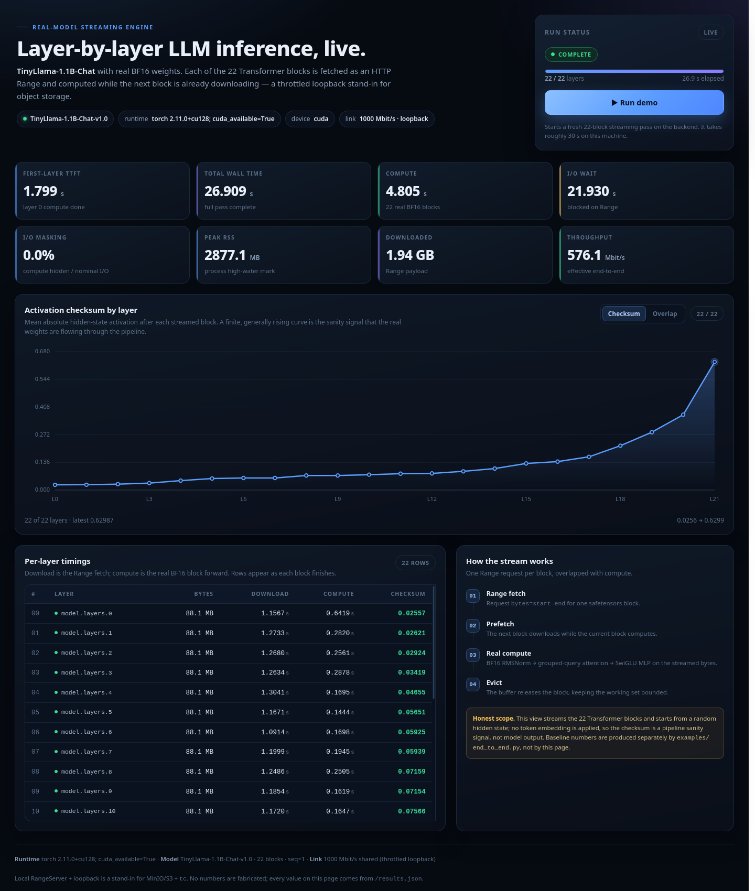
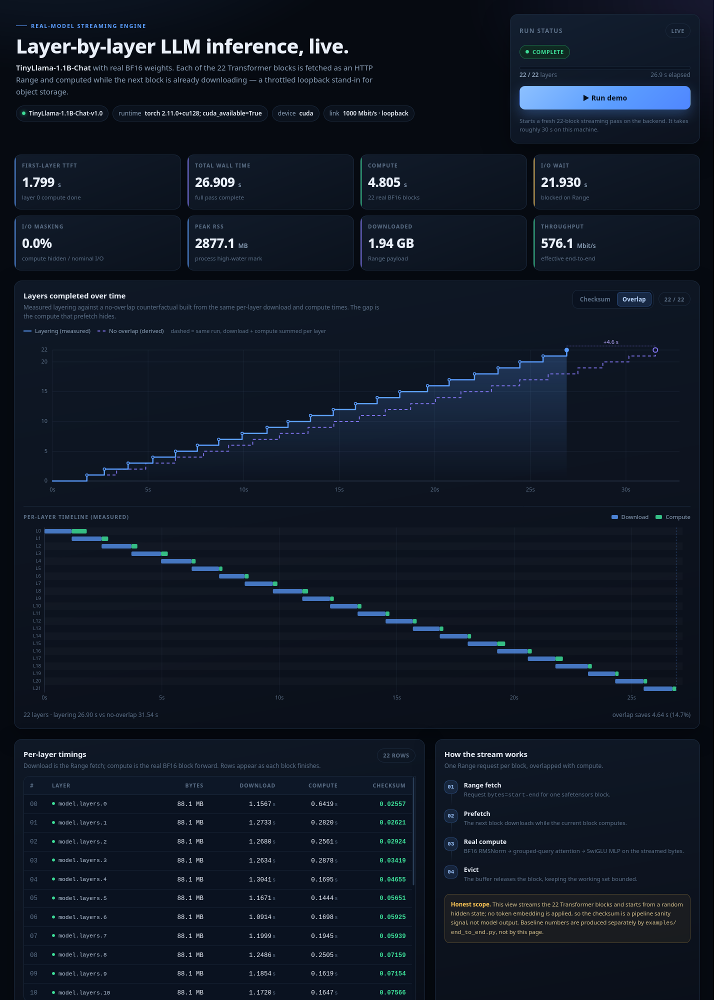
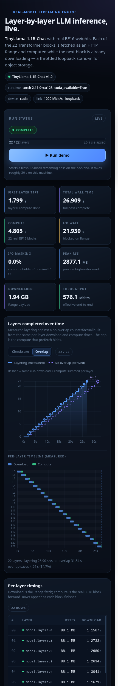

# Streaming a Real LLM, Layer by Layer

**Demo and presentation brief — TinyLlama-1.1B-Chat with real BF16 weights**

| | |
|---|---|
| **Project** | Design and Empirical Evaluation of an Asynchronous Progressive Layer-Streaming Engine for Accelerating Serverless LLM Invocations |
| **Course** | IS355TBD (Cloud Computing), 5th Semester, RVCE — Experiential Learning |
| **Model** | TinyLlama-1.1B-Chat-v1.0, 22 Transformer blocks, BF16, 2.20 GB checkpoint |
| **Runtime** | `torch 2.11.0+cu128`, `cuda_available=True`, device `cuda` |
| **Prepared** | 20 November 2026 |
| **Status** | Verified against the live demo server; all numbers below are measured unless explicitly marked *derived* or *theoretical* |

> **Thesis in one sentence.** A serverless LLM worker does not need the whole 2.2 GB checkpoint before it starts: fetch one layer over HTTP Range, compute it while the next layer downloads, and the first layer is ready in ~2 s instead of ~31 s.

---

## Contents

1. Executive summary
2. The problem, explained properly
3. The idea in one picture
4. Architecture and components
5. How one live run works
6. Metrics and formulas
7. The live demo
8. Results
9. Why this matters
10. Honest scope and limitations
11. Five-minute demo script
12. Q&A preparation
13. Reproduce and troubleshoot
14. File map
15. Glossary

Appendices: **A** `/results.json` contract · **B** Provenance of every number · **C** Verification status · **D** Presentation checklist

---

## 0. How to use this document

Three reading paths:

1. **Before the presentation** — read §1 (summary), §7 (demo tour), §11 (script), and §12 (Q&A).
2. **While presenting** — keep §7 and §8 open; the screenshots are in `docs/images/`.
3. **If an examiner asks for detail** — §4 (architecture), §6 (metrics), §9 (interpretation), §10 (limitations), and Appendix B (provenance of every number).

A one-line honesty rule runs through the whole document: **do not quote a number outside the run and conditions that produced it.** The synthetic 62.6% masking result and the real-model 0.0 masking result are both correct, but they belong to different experiments.

---

## 1. Executive summary

### The problem

A conventional serverless LLM cold start is serial:

```text
provision worker → download ALL weights → deserialise → run all layers → first token
                   └──────────── D ────────┘   └──── C ────┘
```

For TinyLlama that is 2.2 GB before any compute; for a 7B FP16 model it is ~14 GB. The download and the forward pass do not overlap, so time-to-first-token (TTFT) is at least `D + C` plus cold-start overhead.

### The idea

A Transformer is sequential across layers, but the **bytes for layer `i+1`** can arrive while layer `i` is computing. If the checkpoint is addressed as per-layer byte ranges, the worker can start at layer 0 and prefetch ahead:

```text
layer 0 fetch ──▶ layer 0 compute ──▶ layer 1 compute ──▶ ... ──▶ last layer
                   layer 1 fetch ─────┘
                   layer 2 fetch ─────────────────┘
```

This is an **overlap** technique, not a model-skipping technique. Every layer is still computed before a real token can be emitted, so the ideal total-time ceiling is roughly a factor of two, not an order of magnitude. The large, structural win is **first-layer latency**: the worker no longer waits for the whole file.

### What is actually real in this build

- Real TinyLlama-1.1B-Chat BF16 weights from `models/tinyllama.safetensors`.
- A real decoder Transformer block forward pass per layer: RMSNorm → Q/K/V projections → grouped-query attention → SwiGLU MLP → residual.
- Real HTTP `Range` requests with `206 Partial Content`, served by a local throttled RangeServer.
- Real per-layer timings, checksums, RSS sampling, and a live browser dashboard.
- The demo deliberately omits token embedding and the LM head, and starts from a random hidden state. The checksum is a **pipeline sanity signal**, not model output. This is stated on the page itself.

### Headline results

**Controlled real-model A/B** — same script, same machine, same 1 Gbit/s link (`results/real_model_end_to_end.csv`, 2026-11-11):

| Metric | Monolithic baseline | Layer-streaming pipeline | Change |
|---|---:|---:|---:|
| First-layer latency | **31.05 s** | **2.14 s** | **14.5× lower** |
| Total forward pass | **38.26 s** | **30.73 s** | **19.7% lower (1.25×)** |
| I/O wait | 30.81 s | 24.69 s | −6.12 s |
| Compute | 3.57 s | 6.04 s | run variance / per-layer binding |
| Bytes downloaded | 2.20 GB (whole file) | 1.94 GB (22 blocks) | −0.26 GB |
| Peak RSS | not sampled | 2890 MB | — |
| Masking ratio | 0.000 | 0.000 | I/O-bound at 1 Gbit/s |

**Latest live demo run** — the numbers the dashboard shows (`web/results.json`, 2026-11-20, CUDA):

| Metric | Value |
|---|---:|
| Layers completed | **22 / 22** |
| First-layer latency | **1.80 s** |
| Total wall time | **26.91 s** |
| Compute (22 real blocks) | **4.80 s** |
| I/O wait | **21.93 s** |
| Masking ratio | **0.0** |
| Peak RSS | **2877 MB** |
| Downloaded | **1.94 GB** |
| Effective throughput | **576 Mbit/s** |
| Derived no-overlap time | **31.54 s** |
| Overlap saving | **≈4.63 s (14.7%)** |

**Controlled synthetic A/B** — isolates the mechanism at 8 Mbit/s (`results/benchmark.csv`, 3 runs per mode):

| Metric (mean) | Monolithic | Pipelined | Change |
|---|---:|---:|---:|
| TTFT (full forward) | 15.702 s | 10.816 s | **−31.1% (1.45×)** |
| First-layer fill | 9.582 s | 3.959 s | diagnostic only |
| I/O masking | 0.000 | **0.626** | 62.6% |
| Peak RSS | 53.67 MB | 48.28 MB | reported, **not claimed as a win** |

### The honest one-liner

> At 1 Gbit/s the link dominates: the streaming pipeline cuts first-layer latency by **14.5×** and total time by **19.7%**, but masking is **0%** because per-layer compute (~0.2 s) is far smaller than per-layer transfer (~1.2 s). On a slower 8 Mbit/s link, where the ratios are comparable, the same mechanism hides **62.6%** of the I/O.

---

## 2. The problem, explained properly

### 2.1 Why serverless makes it worse

A serverless worker is created on demand, handles a request, and is torn down. The next request may land on a different worker with an empty cache. For an LLM this means the weight-loading cost is paid repeatedly, and it sits directly on the user-visible latency path.

### 2.2 Why “just download faster” is not the whole answer

Even on a fast link, the conventional path forces a barrier: nothing can compute until the entire checkpoint is present. Layer streaming removes that barrier. It does not reduce the number of bytes needed for a full forward pass; it changes **when** those bytes are needed.

### 2.3 What TTFT means here

In a production LLM, TTFT is the time from request arrival to the **first emitted token**. A decoder needs every layer for the prompt's last position before it can produce that token, so a real TTFT is measured after the full forward pass.

This demo reports **first-layer latency** (`first_layer_s`): the time until layer 0's compute finishes. That is a **TTFT proxy / streaming-fill metric**, not a real token. The page labels it “First-layer TTFT”; the honest interpretation is “time until the first block is ready.” The controlled A/B in §8 uses the full-forward TTFT, which is the correct end-to-end number.

### 2.4 Why the ceiling is modest

For uniform layers with download `d` and compute `c`:

```text
T_pipeline = startup + d + c + (L − 1) · max(d, c) + tail
```

The first layer is always exposed; every later layer costs only the larger of download and compute. If `d >> c`, the pipeline is still I/O-bound and the total saving is small. If `c >> d`, the pipeline is compute-bound and the total saving is small. The mechanism pays off when `d` and `c` are comparable — which is why the 8 Mbit/s synthetic run shows 62.6% masking and the 1 Gbit/s real run shows 0%.

---

## 3. The idea in one picture

```text
Monolithic (baseline):
  |==== download 2.20 GB (30.81 s) ====|== compute (3.57 s) ==|  first layer at 31.05 s

Layer streaming:
  |== L0 fetch ==|== L0 compute ==|
                 |== L1 fetch ==|== L1 compute ==|
                                |== L2 fetch ==|== L2 compute ==|
                                                ...
  first layer at 2.14 s; total 30.73 s
```

The first block is unavoidable. Everything after it is a scheduling problem: keep the link busy while the compute unit works, and keep the buffer small enough that memory stays bounded.

---

## 4. Architecture and components

### 4.1 Runtime topology

```text
┌──────────────────────┐   poll /results.json   ┌──────────────────────────┐
│ Browser dashboard    │ ─────────────────────▶ │ web/demo_server.py :8000 │
│ web/demo.html        │ ◀───────────────────── │  - serves the UI         │
│                      │     live JSON           │  - runs one pass         │
└──────────────────────┘                        │  - prefetch + compute    │
                                                └────────────┬─────────────┘
                                                             │ HTTP Range
                                                             │ bytes=start-end
                                                ┌────────────▼─────────────┐
                                                │ RangeServer :8001        │
                                                │ 206 Partial Content      │
                                                │ 1000 Mbit/s throttle     │
                                                └────────────┬─────────────┘
                                                             │
                                                ┌────────────▼─────────────┐
                                                │ models/tinyllama.        │
                                                │ safetensors (2.20 GB)    │
                                                └──────────────────────────┘
```

The browser never talks to the object store. It only polls a small JSON snapshot; the backend does the Range fetching and the real compute.

### 4.2 Component table

| Component | File | Responsibility |
|---|---|---|
| Safetensors parser | `src/storage/safetensors_ranges.py` | Reads the 8-byte header length and JSON header; converts tensor `data_offsets` to absolute file ranges; groups tensors by `model.layers.N`. |
| RangeServer | `src/storage/RangeServer.py` | Stdlib `ThreadingHTTPServer` with `Range` / `206` / `416`, `HEAD`, `Accept-Ranges`, and a **global** token-pacing throttle (chunked sleep). The global limiter models one shared client link, not one private pipe per request. |
| Async prefetcher (main harness) | `src/core/AsyncPrefetcher.py` | Asyncio HTTP Range client with lookahead, concurrency limits, retries/resume, and backpressure. |
| Fallback prefetcher (demo) | `src/bench/BenchmarkHarness.py` | Simpler asyncio prefetcher used by the live demo; `lookahead=2`, which keeps one layer in flight ahead of the current block. |
| Pipeline driver | `src/core/PipelineDriver.py` | Main-harness coordinator: get layer → bind tensors → compute → evict; records TTFT, per-layer times, I/O wait, masking, RSS. |
| Real compute engine | `src/core/RealModelComputeEngine.py` | Real TinyLlama block forward pass: RMSNorm, QKV, GQA (32 query heads, 4 KV heads, head dim 64), SwiGLU MLP, residual. BF16 decode; CUDA synchronisation before timing. |
| RSS sampler | `src/bench/BenchmarkHarness.py` | Samples resident set size at a fixed interval and records the peak. |
| Benchmark harness | `src/bench/BenchmarkHarness.py` | Runs baseline vs pipeline, writes CSVs, computes summary metrics. |
| Real-model A/B script | `examples/end_to_end.py` | End-to-end verifier: real engine, AsyncPrefetcher + PipelineDriver, baseline vs pipeline, live demo check. |
| Live demo backend | `web/demo_server.py` | Starts RangeServer on 8001 and UI on 8000; auto-runs one 22-layer pass; exposes `/results.json`, `/health`, `/run`, `/demo.html`. |
| Live dashboard | `web/demo.html` | Self-contained dark UI: status, metrics, checksum chart, overlap chart + Gantt, per-layer table. No external libraries. |

### 4.3 Model facts used in the demo

| Fact | Value |
|---|---|
| Checkpoint | `models/tinyllama.safetensors` |
| File size | 2,200,119,864 bytes (2.20 GB / 2098 MiB) |
| Transformer blocks | 22 (`model.layers.0` … `model.layers.21`) |
| Hidden size | 2048 |
| Attention | 32 query heads, 4 KV heads, head dim 64 (GQA) |
| MLP | SwiGLU (`gate_proj`, `up_proj`, `down_proj`) |
| Weight dtype | BF16 |
| Bytes per block | 88,088,576 |
| Block bytes streamed | 22 × 88,088,576 = **1,937,948,672 (1.94 GB)** |
| Not streamed in the demo | `model.embed_tokens`, `model.norm`, `lm_head` (the demo starts from a random hidden state) |
| Checkpoint order | Lexicographic in the file (0, 1, 10, 11, …, 2, 20, …); the code reorders to numeric 0…21 before the forward pass |

---

## 5. How one live run works

This is the exact sequence in `web/demo_server.py`:

1. **Start.** RangeServer binds `127.0.0.1:8001`; the UI server binds `127.0.0.1:8000`; one run is triggered automatically.
2. **Reset.** Clear `live_results.json`, clear the summary, initialise a random hidden state `[1, 1, 2048]` with values in `[-0.05, 0.05]`.
3. **Build the manifest.** For each of the 22 blocks, record `{start, end, dtype: BF16}` from the RangeServer's parsed manifest.
4. **Prefetch layer 0.** `FallbackPrefetcher` starts fetching block 0. It gets the full shared link first, which is why layer 0 is the exposed fill cost.
5. **Compute layer 0.** When the bytes arrive, `RealModelComputeEngine.run_layer` decodes the BF16 tensors and runs the block forward pass on CUDA. `first_layer_s` is recorded when this finishes.
6. **Steady state.** For each next block `i`:
   - `pref.get(i)` waits only if the block is not already in flight;
   - compute block `i`;
   - schedule block `i+1` while computing;
   - append a row with `download_s`, `compute_s`, `blocked_s`, `checksum`, `elapsed_s`, and exact fetch/compute intervals;
   - write the row to `web/live_results.json`.
7. **Finish.** Stop the RSS sampler, compute totals, write `web/results.json`, set `status = "done"`.
8. **UI.** The page polls `/results.json` every 500 ms and re-renders. The Run button issues `POST /run`, which starts another pass.

### 5.1 Measured timeline of the latest run

| Stage | Time |
|---|---:|
| Layer 0 download | 1.157 s |
| Layer 0 compute | 0.642 s |
| **First-layer latency** | **1.799 s** |
| Mean download per later layer | ~1.22 s |
| Compute per later layer | median ~0.17 s, mean ~0.20 s (layer 0 warm-up is 0.64 s) |
| I/O wait (sum of blocked time) | 21.930 s |
| Total wall time | 26.909 s |
| Effective throughput | 576 Mbit/s |

The per-layer table in the UI shows the same pattern: download ~1.1–1.4 s, compute ~0.14–0.34 s after the 0.64 s warm-up layer. Compute is hidden behind the *next* download; the pipeline is limited by the link, not the GPU.

### 5.2 Why the demo uses a “fallback” prefetcher

`FallbackPrefetcher` is the dependency-light asyncio implementation used by the live demo. The main harness uses `AsyncPrefetcher` + `PipelineDriver`, which expose the same overlap with more instrumentation. Both follow the same contract: `get(layer)` returns bytes, compute runs on those bytes, the next layer is scheduled ahead. The demo's lookahead is 2, but `get()` keeps at most `lookahead − 1 = 1` layer in flight ahead of the current one, so the shared link is not split across many future layers.

---

## 6. Metrics and formulas

### 6.1 Definitions

| Metric | Meaning | Where it comes from |
|---|---|---|
| `first_layer_s` | Time from run start until layer 0's compute finishes | `c_end − t0` for `i = 0` |
| `total_s` | Time for all 22 blocks, including all fetches and computes | `perf_counter` after the loop |
| `compute_s` | Sum of real block forward-pass times | Sum of `c_end − c_start` |
| `io_wait_s` | Time the loop actually blocked waiting for a layer | Sum of `blocked_s` |
| `bytes_downloaded` | Bytes fetched by the prefetcher | Sum of payload lengths |
| `throughput_mbps` | Effective end-to-end rate | `bytes × 8 / 1e6 / total_s` |
| `peak_rss_mb` | Process high-water resident memory | `RSSSampler` |
| `masking_ratio` | Fraction of nominal I/O hidden | `clamp(1 − io_wait / nominal_io, 0, 1)` |

### 6.2 Nominal I/O and masking

```text
nominal_io_s = bytes_downloaded / (bandwidth_mbps × 1,000,000 / 8)
masking_ratio = clamp(1 − io_wait_s / nominal_io_s, 0, 1)
```

For the latest run:

```text
bytes           = 1,937,948,672
bandwidth       = 1000 Mbit/s = 125,000,000 B/s
nominal_io_s    = 1,937,948,672 / 125,000,000 = 15.50 s
io_wait_s       = 21.93 s
masking_ratio   = clamp(1 − 21.93 / 15.50, 0, 1) = 0.0
```

`io_wait` exceeds the nominal transfer time because the local server's chunked pacing delivers ~576 Mbit/s, not the configured 1000 Mbit/s. When the denominator is optimistic and the measured wait is larger, the ratio clamps to zero. **Zero does not mean “no overlap.”** It means “the nominal link is not the bottleneck model that this ratio assumes.” The overlap is still visible in the derived counterfactual and the Gantt.

### 6.3 The derived no-overlap counterfactual

The Overlap view adds a dashed line built from the same run:

```text
serial_i = Σ_{j=0..i} (download_j + compute_j)
```

This answers: “What would these exact 22 fetches and computes have cost if each layer had to finish downloading before its compute, with no prefetch?” It is a **counterfactual derived from measured per-layer durations**, not a second measured run. The page labels it “No overlap (derived)” and the legend says so.

For the latest run:

```text
serial total = 31.539 s
measured     = 26.909 s
saving       = 4.630 s = 14.7%
```

The UI footer reads “overlap saves 4.64 s (14.7%)” and the bracket reads “+4.6 s”, because the page subtracts the last row's completion time (26.90 s) rather than the final summary total (26.909 s). Both round to the same story; quote 4.6 s / 14.7% either way.

### 6.4 What “masking” does and does not mean

Masking is not “the network was idle.” It is “this fraction of the nominal transfer time was not exposed as blocking wait.” With `lookahead=2` and a 1 Gbit/s link:

- each layer takes ~1.2 s to download;
- each block takes ~0.2 s to compute (median 0.17 s);
- the next download starts during compute, hiding ~0.2 s per layer;
- the remaining ~1.0 s per layer is still exposed;
- total ≈ 22 × 1.2 s, which is what the 26.9 s total shows.

On the 8 Mbit/s synthetic run, download and compute are comparable, so the same mechanism hides 62.6%.

---

## 7. The live demo

### 7.1 Run it

The system Python does not have torch. Use the project venv:

```bash
cd /home/bhandi/opencode-test

/home/bhandi/.hermes/installs/6dbeb051a43d0149/environments/f5e1f161ceda4ec89c8cf1e30609f5db/venv/bin/python3 \
  web/demo_server.py
```

Then open:

```text
http://127.0.0.1:8000/
```

The server also accepts `/demo.html`. It auto-runs one pass at startup; the pass takes roughly 25–30 s on this machine. The model file is 2.1 GB and is required.

Useful endpoints:

| Endpoint | Purpose |
|---|---|
| `/` or `/demo.html` | Dashboard |
| `/results.json` | Snapshot: status, rows, final summary, runtime, device, model, elapsed |
| `/live_results.json` | Raw per-layer rows |
| `/health` | `{ok, status, rows}` — quick liveness check |
| `POST /run` | Start a fresh pass (the Run button does this) |

### 7.2 What to show, in order

**1. Hero and status card.** Point out the model, runtime, device, and link chips. The status card shows `Streaming` with a live progress bar, then `Complete` at 22/22.

**2. The eight metric cards.** Read them left to right:

- First-layer latency: how long until block 0 is ready.
- Total wall time: the full 22-block pass.
- Compute: sum of real BF16 block forwards.
- I/O wait: time actually blocked on Range.
- I/O masking: nominal I/O hidden (0% at 1 Gbit/s).
- Peak RSS: process high-water mark.
- Downloaded: 1.94 GB of layer payload.
- Throughput: effective end-to-end rate.

**3. Checksum chart.** The hidden state is random-initialised, so the absolute values are run-specific. What matters is that the curve is finite and generally rising: real weights are flowing and the block math is not producing NaNs. Say this explicitly; do not present the checksum as model quality.

**4. Overlap view.** Click **Overlap**. The solid staircase is the measured run. The dashed staircase is the derived no-overlap counterfactual. The bracket at the top shows the saving. Below it, the Gantt shows the actual per-layer download and compute intervals: the blue bars march forward, and the green compute bars sit under the next layer's blue bar. Hover any row to see its exact windows.

**5. Per-layer table.** Download, compute, checksum per block. Rows appear as the run progresses. This is the evidence behind the chart.

**6. Honesty note.** Read it aloud once: random hidden state, no token embedding, checksum is a sanity signal, baseline numbers come from a separate script.

### 7.3 Screenshots

Checksum view:



Overlap view with the derived no-overlap curve and the per-layer Gantt:



Mobile layout:



### 7.4 What not to say

- Do not say “the model generated a token.” It did not; there is no embedding or LM head in the demo.
- Do not say “14.5× faster overall.” Say “14.5× lower first-layer latency; 1.25× lower total in the controlled real-model A/B.”
- Do not say “62.6% masking” while showing the 1 Gbit/s demo. That number belongs to the 8 Mbit/s synthetic experiment.
- Do not claim a memory win. The demo's RSS is ~2.9 GB; the buffer is not the only copy of the weights.
- Do not call the loopback server “S3” or “serverless.” It is a protocol-level stand-in.

---

## 8. Results

### 8.1 Controlled synthetic A/B — the mechanism

Source: `results/benchmark.csv` (2026-11-11). Synthetic 8-layer F32 checkpoint, 8.00 MiB, local RangeServer, 8 Mbit/s shared throttle, 3 runs per mode.

| Metric (mean) | Monolithic | Pipelined | Change |
|---|---:|---:|---:|
| TTFT, full forward | 15.702 s | 10.816 s | **−31.1% (1.45×)** |
| First-layer fill | 9.582 s | 3.959 s | diagnostic only, not TTFT |
| I/O masking | 0.000 | **0.626** | 62.6% |
| Peak RSS | 53.67 MB | 48.28 MB | reported, not claimed |

**What it proves:** when download and compute are comparable, the prefetcher hides most of the transfer. The measured masking is 0.626, just under the first-layer ceiling `1 − d0/D ≈ 0.627`; every layer after layer 0 was already buffered when compute needed it.

**What it does not prove:** the compute is synthetic, the model is 8 MiB, and the link is 8 Mbit/s. It is mechanism evidence, not a production benchmark.

### 8.2 Controlled real-model A/B — the realistic comparison

Source: `results/real_model_end_to_end.csv` (2026-11-11). TinyLlama-1.1B-Chat, real BF16 blocks, `torch 2.11.0+cu128`, CUDA, 1 Gbit/s nominal, same script for both modes.

| Metric | Baseline (full pre-download) | Pipeline (streaming) | Change |
|---|---:|---:|---:|
| First-layer latency | 31.05 s | **2.14 s** | **14.5× lower** |
| Total forward pass | 38.26 s | **30.73 s** | **−19.7% (1.25×)** |
| I/O wait | 30.81 s | 24.69 s | −6.12 s |
| Compute | 3.57 s | 6.04 s | run variance / binding |
| Slice/copy time | 3.81 s | — | baseline-only |
| Bytes downloaded | 2.20 GB | 1.94 GB | −0.26 GB |
| Peak RSS | not sampled | 2890 MB | — |
| Masking ratio | 0.000 | 0.000 | I/O-bound |

Why the total win is only 1.25×: the baseline downloads 2.20 GB and the pipeline downloads 1.94 GB, but both are limited by the same ~570–630 Mbit/s effective loopback rate. The pipeline saves the serialisation of download and compute, and it avoids fetching the non-block bytes, but it still must move ~1.94 GB. The large structural win is the first layer.

### 8.3 Latest live demo run — the dashboard numbers

Source: the live snapshot served at `/results.json` by `web/demo_server.py` on 2026-11-20. Its final summary is checked into `web/results.json`; its 22 per-layer rows are in `web/live_results.json`.

| Metric | Value |
|---|---:|
| Layers | 22 / 22 |
| First-layer latency | 1.799 s |
| Total wall time | 26.909 s |
| Compute | 4.805 s |
| I/O wait | 21.930 s |
| Masking ratio | 0.000 |
| Peak RSS | 2877.1 MB |
| Bytes downloaded | 1,937,948,672 (1.94 GB) |
| Effective throughput | 576.1 Mbit/s |
| Derived no-overlap | 31.539 s |
| Overlap saving | 4.630 s (14.7%) |
| Checksum range | 0.0256 → 0.6299 |
| Local dips in checksum | 1 (normal; random hidden state) |

Per-layer statistics:

| Phase | Sum | Mean | Median | Min | Max |
|---|---:|---:|---:|---:|---:|
| Download | 26.734 s | 1.215 s | 1.197 s | 1.091 s | 1.389 s |
| Compute | 4.805 s | 0.218 s | 0.167 s | 0.144 s | 0.642 s |
| Blocked | 21.930 s | 0.997 s | 1.002 s | 0.624 s | 1.157 s |

Layer 0's compute is 0.642 s, much larger than the ~0.17 s steady-state blocks; this is warm-up (CUDA context, first kernel launch, allocator). It is included honestly, not hidden.

### 8.4 CPU vs GPU at `seq = 1`

Source: `results/end_to_end.csv` (2026-11-20), same script, two device runs.

| Device | Total | Compute | I/O wait | First layer | Peak RSS | Prefetcher throughput |
|---|---:|---:|---:|---:|---:|---:|
| CPU | 19.05 s | 3.32 s | 15.57 s | 1.74 s | 1032 MB | 814 Mbit/s |
| CUDA | 20.28 s | 5.39 s | 14.75 s | 2.06 s | 1336 MB | 765 Mbit/s |

At `seq = 1` the GEMMs are tiny; CUDA kernel-launch and host-to-device overhead can exceed the CPU OpenBLAS matvec time. The GPU advantage appears at larger batch/sequence, where the work becomes compute-bound. This is a useful, honest caveat: **the GPU is not why this pipeline is fast; the overlap is.**

### 8.5 Interpretation

1. **First-layer latency is the real structural win.** 31.05 s → 2.14 s in the controlled A/B; 1.80 s in the live demo. The worker starts computing after ~88 MB, not 2.2 GB.
2. **Total time improves modestly at 1 Gbit/s.** 38.26 s → 30.73 s (1.25×). The link, not the GPU, is the bottleneck.
3. **Masking is a regime property, not a constant.** 62.6% at 8 Mbit/s synthetic; 0% at 1 Gbit/s real. Quote the regime with the number.
4. **The derived counterfactual isolates the overlap.** Same 22 fetches, same computes, no prefetch: 31.54 s vs 26.91 s, a 4.63 s (14.7%) saving.
5. **A single full-file GET can beat 22 Range requests at very high bandwidth.** Back-of-envelope: 1.94 GB at a true 1000 Mbit/s is 15.5 s; plus 4.8 s compute is ~20.3 s, below the measured 26.9 s. The local server actually delivers ~576 Mbit/s and each of the 22 requests carries ~0.5 s of overhead. The streaming design wins on **first-layer latency and low-bandwidth/overlap regimes**, not on raw request efficiency at 1 Gbit/s. Say this before an examiner does.

---

## 9. Why this matters

- **Cold-start latency is user-visible.** A 14.5× reduction in first-layer readiness is the difference between a worker that feels dead and one that starts producing work quickly.
- **The mechanism is portable.** HTTP Range and safetensors are standard; the same logic maps to S3/MinIO `GetObject` ranges and `tc` shaping.
- **The accounting is honest.** The project reports where the win is (first layer, overlap in the right regime) and where it is not (memory, total time at high bandwidth). That is more defensible than a broad claim.
- **It composes with serving systems.** vLLM/PagedAttention, FastServe, and ServerlessLLM solve adjacent problems; layer streaming addresses the cold path before steady-state serving begins.

### Related work in one line each

| Work | What it solves | How this project differs |
|---|---|---|
| ServerlessLLM (OSDI '24) | Checkpoint loading and live migration for serverless inference | Streams individual layers over Range to a worker; no GPU-resident full checkpoint |
| LLM in a Flash (2023) | Weights exceed device DRAM; stream from flash | Targets remote object storage with a static manifest, not local flash; no predictor |
| vLLM / PagedAttention (SOSP '23) | KV-cache fragmentation and serving throughput | Optimises steady-state serving; this project targets the cold path before serving begins |
| FastServe (2023) | Queueing delay via request scheduling | Schedules requests; this project shortens the weight-fetch path before scheduling matters |
| SOCK (ATC '18) | Container provisioning and dependency prefetch | Streams model-internal weights; SOCK stops at the process boundary |

The claimed intersection: **layer-granular random access to a safetensors checkpoint + remote Range retrieval + async prefetch/compute overlap + bounded buffering, aimed at serverless cold-start TTFT.**

---

## 10. Honest scope and limitations

Read these before the presentation. They are not weaknesses to hide; they are the boundaries that make the claims credible.

### 10.1 What the demo does not do

1. **No token embedding, no LM head.** The demo streams only the 22 Transformer blocks (1.94 GB of the 2.2 GB file). The hidden state starts random. The checksum is a pipeline sanity signal, not a generated token.
2. **Single token (`seq = 1`).** The forward pass is one position. Multi-token prompts grow the GEMM term and can change the compute/I/O balance.
3. **No real serverless deployment.** Local RangeServer over loopback, in-process throttle. It does not model container provisioning, cold-start queues, cross-AZ jitter, S3 throttling, or multi-tenant contention.
4. **No peak-RSS claim.** The process holds the full file mapping/weights plus transient buffers. The measured ~2.9 GB is not a memory win; a real streaming parameter store would be future work.
5. **RoPE is elided in the timed block.** The code defines rotary helpers, but the block forward pass explicitly skips them (there is a `NOTE` in `_transformer_block`). At `seq = 1` the cost is negligible relative to the GEMMs. State it if asked.
6. **F16/F32 decode path is wrong for non-BF16 checkpoints.** `_to_torch_tensor` numerically converts `uint16 → int16 → float16` and `uint8 → int32 → float32` instead of reinterpreting bits. TinyLlama is BF16, so this run is unaffected, but the bug matters for other dtypes.
7. **The fallback parser collapses `transformer.h.N` names into one layer.** TinyLlama uses `model.layers.N`, so the demo is unaffected; GPT-2-style checkpoints would need a fix.
8. **`real_benchmark.py` prints “CPU runtime” even when CUDA is available.** The string is misleading; the measured device is reported in the CSV. Treat the console label with suspicion, not the data.
9. **`results/per_layer.csv` is from an earlier run and does not line up with the current CSVs.** Use `results/end_to_end.csv` and `results/real_model_end_to_end.csv` for current per-layer data.
10. **Runs and configurations are not interchangeable.** The 2026-11-20 demo reported 1.799 s first layer / 26.909 s total; the controlled A/B reported 2.141 s / 30.732 s. Quote the run you are showing, not a remembered constant.

### 10.2 What the numbers do not support

- “Streaming is always faster than a single full-file GET.” At 1 Gbit/s with 22 Range requests, it may not be. The win is first-layer latency and the low-bandwidth regime.
- “Masking is 62.6% in the demo.” No; that is the 8 Mbit/s synthetic run.
- “The GPU makes this fast.” No; at `seq = 1` the CPU is often faster. The overlap makes it fast.
- “Memory is reduced.” No claim.
- “This is production-ready.” No; it is a mechanism prototype.

---

## 11. Five-minute demo script

### Before you start (2 minutes before)

- [ ] Model file exists: `ls -lh models/tinyllama.safetensors` → ~2.1 GB.
- [ ] Ports 8000/8001 are free: `ss -ltnp | grep -E ':(8000|8001)\b'`.
- [ ] Start the server with the venv command from §7.1.
- [ ] Open `http://127.0.0.1:8000/` in a browser; wait for 22/22.
- [ ] Keep `docs/images/demo-overlap.png` open as a backup in case the live run fails.
- [ ] Have this document open at §7 and §8.

### Minute-by-minute

**0:00 — Hook.**
> “A serverless LLM worker normally downloads the entire 2.2 GB checkpoint before it can compute anything. We asked: can it start after the first layer instead?”

**0:40 — The idea.**
> “A Transformer is sequential across layers, but the next layer's bytes can arrive while the current layer computes. We treat the safetensors file as per-layer byte ranges and prefetch ahead.”

**1:10 — Start the run.**
> “This is a real TinyLlama-1.1B, real BF16 weights, real Transformer blocks. The backend is fetching over HTTP Range from a throttled local server.”

**1:30 — Metrics.**
> “First layer is ready in about 1.8 seconds. The full pass is about 27 seconds. Compute is 4.8 seconds; I/O wait is 21.9 seconds. That tells you the link is the bottleneck at 1 Gbit/s.”

**2:10 — Checksum chart.**
> “The hidden state is random-initialised, so these values are run-specific. The point is that they are finite and generally rising: real weights are flowing and the block math is healthy. This is not a generated token.”

**2:40 — Overlap view.**
> “Switch to Overlap. The solid staircase is measured. The dashed one is the same 22 fetches with no prefetch, derived from the same per-layer durations. The gap is about 4.6 seconds, or 14.7%. The Gantt shows why: each green compute bar sits under the next blue download bar.”

**3:40 — Results table.**
> “In the controlled real-model A/B, first-layer latency went from 31 seconds to 2.1 seconds, a 14.5× reduction. Total time went from 38.3 to 30.7 seconds, 19.7% lower. Masking is zero here because compute is tiny relative to transfer. On an 8 Mbit/s link, the same mechanism hides 62.6%.”

**4:30 — Honesty.**
> “We do not claim a memory win. We do not claim this is a production serverless deployment. The checksum is a sanity signal, not model output. What we do claim is a real, reproducible first-layer latency win and an honest accounting of where overlap helps.”

**4:50 — Close.**
> “The next steps are multi-token batches, a real MinIO/S3 backend, and a streaming parameter store that would make the memory claim real.”

---

## 12. Q&A preparation

### Q1. What exactly is TTFT, and why does the demo call it first-layer latency?

In production, TTFT is request arrival to first emitted token; a decoder needs every layer for the prompt's last position, so the full forward pass is on the critical path. The demo's `first_layer_s` is the time until block 0 finishes, which is a **TTFT proxy / streaming-fill metric**. The controlled A/B reports the full-forward TTFT, which is the correct end-to-end number.

### Q2. Why is masking 0% in the live demo?

`masking_ratio = clamp(1 − io_wait / nominal_io, 0, 1)`. The nominal I/O for 1.94 GB at 1000 Mbit/s is 15.50 s; the measured I/O wait is 21.93 s because the local server actually delivers ~576 Mbit/s and each of the 22 requests carries overhead. The ratio clamps to 0. The overlap still exists; it is just small relative to the transfer at this bandwidth.

### Q3. Is streaming actually faster than downloading the whole file?

For first-layer latency, yes, dramatically: 31.05 s → 2.14 s in the controlled real-model A/B. For total time, modestly: 38.26 s → 30.73 s (1.25×). At a true 1 Gbit/s with no per-request overhead, a single full-file GET could be ~20 s, which would beat 22 Range requests. The streaming win is structural at cold start and in low-bandwidth/overlap regimes, not raw request efficiency at high bandwidth.

### Q4. Is the compute real?

Yes. Each block runs RMSNorm, QKV projections, grouped-query attention (32 query heads, 4 KV heads, head dim 64), SwiGLU MLP, and residuals over the real BF16 weights. It is not a synthetic kernel. The demo omits embedding and LM head, and starts from a random hidden state; the checksum is therefore a sanity signal, not a token.

### Q5. Why is the GPU not obviously faster?

At `seq = 1`, each GEMM is tiny and kernel-launch/host-to-device overhead dominates. In the 2026-11-20 device run, CPU compute was 3.32 s and CUDA compute was 5.39 s. The GPU advantage appears at larger batch/sequence. The pipeline's speed comes from overlap, not from the GPU.

### Q6. Where is the memory saving?

There is none claimed. The process holds the weights plus transient buffers; peak RSS is ~2.9 GB. The ring buffer bounds prefetched payloads, but it is not the only copy of the model. A true streaming parameter store (per-layer allocation/free, `madvise`, or a tiered store) is future work.

### Q7. Why safetensors and HTTP Range, not mmap?

`mmap` works locally but cannot map an S3 object across the network. Safetensors is self-describing, random-access by construction, and avoids pickle code execution. HTTP Range makes a layer a first-class network request: `bytes=start-end`, `206 Partial Content`.

### Q8. What is the dashed line in the Overlap view?

A derived counterfactual: the same 22 measured download and compute durations, summed per layer as if each layer had to finish downloading before its compute, with no prefetch. It is labeled “No overlap (derived)” and is not a second measured run.

### Q9. Is this a real serverless deployment?

No. It is a local RangeServer over loopback with an in-process bandwidth throttle, a stand-in for MinIO/S3 + `tc`. It preserves the protocol behaviour under test (Range, 206, request latency, bandwidth ceiling) but not container provisioning, cross-AZ jitter, or multi-tenant contention. The results support relative mechanism conclusions, not production SLAs.

### Q10. How is this different from ServerlessLLM / LLM in a Flash / vLLM?

Those solve adjacent problems: checkpoint loading and migration, flash-resident weights, KV-cache throughput. This project combines layer-granular remote Range streaming, async prefetch/compute overlap, and bounded buffering at the cold-start boundary, with an explicit honest accounting of what overlap achieves on a single CPU/GPU worker.

### Q11. What would you do next?

Multi-token/batched prompts (to make compute comparable to I/O), a real MinIO/S3 backend with `tc`, token embedding + LM head in the stream, a per-layer RSS trace, and fixes for the F16/F32 decode path and the `transformer.h.N` parser. Also a lower-bandwidth demo profile (e.g. 200 Mbit/s) where the overlap story is visually stronger.

### Q12. Why does the checksum sometimes dip?

The hidden state is random-initialised and the values are run-specific. A small local dip is normal; the meaningful signal is that all values are finite and the curve rises overall. It is not a quality metric and not a token probability.

---

## 13. Reproduce and troubleshoot

### 13.1 Commands

```bash
cd /home/bhandi/opencode-test

# Live demo (uses the venv with torch)
/home/bhandi/.hermes/installs/6dbeb051a43d0149/environments/f5e1f161ceda4ec89c8cf1e30609f5db/venv/bin/python3 \
  web/demo_server.py

# In another terminal: liveness and snapshot
curl -s http://127.0.0.1:8000/health
curl -s http://127.0.0.1:8000/results.json | head -c 400

# Real-model end-to-end verifier (starts its own demo server)
/home/bhandi/.hermes/installs/6dbeb051a43d0149/environments/f5e1f161ceda4ec89c8cf1e30609f5db/venv/bin/python3 \
  examples/end_to_end.py --skip-harness --skip-baseline

# Full real-model + harness run (longer)
/home/bhandi/.hermes/installs/6dbeb051a43d0149/environments/f5e1f161ceda4ec89c8cf1e30609f5db/venv/bin/python3 \
  examples/end_to_end.py
```

### 13.2 Common problems

| Symptom | Cause | Fix |
|---|---|---|
| `Address already in use` on 8000/8001 | A previous demo/verifier is still running | `ss -ltnp \| grep -E ':(8000\|8001)\b'`, then kill the PID |
| `ModuleNotFoundError: torch` | Used system `python3` | Use the venv path above |
| `FileNotFoundError: models/tinyllama.safetensors` | Model not present | Restore the 2.1 GB checkpoint; it is gitignored |
| Dashboard stuck at `Connecting` | Backend not running or wrong port | Check `/health`; open `http://127.0.0.1:8000/` |
| Run button disabled | A pass is already running | Wait for 22/22 or check `/health` |
| `cuda_available=False` | CPU-only environment | The demo still runs on CPU; timings differ |

### 13.3 Verification checklist

- [ ] `/demo.html` returns HTTP 200.
- [ ] `/health` reaches `status: done`, `rows: 22`.
- [ ] `/results.json` has 22 rows and a final summary.
- [ ] Checksums are finite; the curve rises overall.
- [ ] `examples/end_to_end.py --skip-harness --skip-baseline` prints `PASS demo`.
- [ ] The Overlap view shows a positive saving and a 22-row Gantt.
- [ ] The page fits a phone-width viewport (no horizontal page overflow).

---

## 14. File map

| Path | Role |
|---|---|
| `web/demo.html` | Self-contained dashboard (HTML + CSS + JS, no external libraries) |
| `web/demo_server.py` | Live demo backend: RangeServer + UI server + run loop + JSON endpoints |
| `web/results.json` | Last completed summary (written by the demo) |
| `web/live_results.json` | Per-layer rows (written incrementally) |
| `src/storage/RangeServer.py` | HTTP Range server with global bandwidth throttle |
| `src/storage/safetensors_ranges.py` | Safetensors header parser and absolute range builder |
| `src/core/RealModelComputeEngine.py` | Real TinyLlama block forward pass |
| `src/core/AsyncPrefetcher.py` | Asyncio Range prefetcher for the main harness |
| `src/core/PipelineDriver.py` | Main-harness layer loop and instrumentation |
| `src/core/MemoryBuffer.py` | Bounded ring/slot buffer (design artifact) |
| `src/bench/BenchmarkHarness.py` | Baseline/pipeline harness, RSS sampler, fallback prefetcher |
| `examples/end_to_end.py` | Real-model A/B verifier and live-demo check |
| `examples/minimal_stream.py` | Minimal stdlib streaming proof |
| `results/benchmark.csv` | Synthetic 8-layer A/B (3 runs/mode, 8 Mbit/s) |
| `results/real_model_end_to_end.csv` | Real-model controlled A/B (2026-11-11) |
| `results/end_to_end.csv` | Latest CPU/CUDA real-model pipeline rows + summaries |
| `results/baseline_run.csv` | Earlier monolithic real-model baseline (44.91 s) |
| `results/README.md` | Real-model measured results and caveats |
| `docs/01_architecture.md` | Full architecture and safetensors design |
| `docs/02_math_model.md` | TTFT, masking, memory, chunking model |
| `docs/PROJECT_EXPLANATION.md` | Plain-English walkthrough |
| `docs/viva_qa.md` | Viva Q&A |
| `docs/images/` | Dashboard screenshots used in this brief |

---

## 15. Glossary

| Term | Meaning |
|---|---|
| **TTFT** | Time to first token. In this project, distinguish full-forward TTFT from the demo's first-layer latency. |
| **Layer streaming** | Fetching one Transformer block's bytes on demand instead of the whole checkpoint. |
| **I/O masking** | Fraction of nominal transfer time hidden behind compute. |
| **Lookahead** | How many layers the prefetcher schedules ahead of the current one. |
| **Range request** | HTTP `Range: bytes=start-end`; the server replies `206 Partial Content`. |
| **Safetensors** | Self-describing tensor file: 8-byte header length, JSON header, data section. |
| **BF16** | Brain floating point, 16-bit; the storage dtype of TinyLlama. |
| **GQA** | Grouped-query attention; here 32 query heads share 4 KV heads. |
| **SwiGLU** | The MLP variant used by Llama (`gate_proj`, `up_proj`, `down_proj` with SiLU). |
| **RSS** | Resident set size; the process's resident memory. |
| **`seq = 1`** | A single-token forward pass; the demo's compute unit. |
| **Counterfactual** | A derived “what if” number computed from measured per-layer durations, not a second measurement. |

---

## Appendix A — The `/results.json` contract

The dashboard consumes this snapshot. Every value on the page comes from here.

```json
{
  "status": "done",
  "rows": [
    {
      "index": 0,
      "layer": "model.layers.0",
      "bytes": 88088576,
      "download_s": 1.157,
      "compute_s": 0.642,
      "blocked_s": 1.157,
      "checksum": 0.0256,
      "elapsed_s": 1.799,
      "fetch_start_s": 0.0,
      "fetch_end_s": 1.157,
      "compute_start_s": 1.157,
      "compute_end_s": 1.799,
      "timestamp": 1795115185.6
    }
  ],
  "final": {
    "first_layer_s": 1.799,
    "total_s": 26.909,
    "compute_s": 4.805,
    "io_wait_s": 21.930,
    "masking_ratio": 0.0,
    "peak_rss_mb": 2877.1,
    "bytes_downloaded": 1937948672,
    "throughput_mbps": 576.1,
    "layers": 22,
    "elapsed_s": 26.909,
    "runtime": "torch 2.11.0+cu128; cuda_available=True",
    "device": "cuda",
    "model": "TinyLlama-1.1B-Chat-v1.0",
    "bandwidth_mbps": 1000.0
  },
  "runtime": "torch 2.11.0+cu128; cuda_available=True",
  "n_layers": 22,
  "bandwidth_mbps": 1000.0,
  "model": "TinyLlama-1.1B-Chat-v1.0",
  "device": "cuda",
  "elapsed_s": 26.909
}
```

Notes:

- `fetch_start_s` / `fetch_end_s` / `compute_start_s` / `compute_end_s` are exact intervals on the same `perf_counter` clock as `elapsed_s`; the Gantt uses them directly.
- Rows are appended as each block finishes; a partial snapshot is valid while `status = "running"`.
- `final` is `null` until the run completes.
- The page polls every 500 ms with `cache: "no-store"`.

---

## Appendix B — Provenance of every number

| Number | Source | Conditions |
|---|---|---|
| 31.05 s → 2.14 s first-layer; 38.26 s → 30.73 s total | `results/real_model_end_to_end.csv` | TinyLlama, real BF16, CUDA, 1 Gbit/s, 2026-11-11, same script for both modes |
| 30.81 s → 24.69 s I/O wait; 3.57 s → 6.04 s compute | same file | same run |
| 2890 MB pipeline RSS | same file | same run |
| 15.702 s → 10.816 s; 0.626 masking; 53.67 → 48.28 MB | `results/benchmark.csv` / `README.md` | Synthetic 8-layer F32, 8 MiB, 8 Mbit/s, 3 runs/mode, 2026-11-11 |
| 1.799 s first layer; 26.909 s total; 4.805 s compute; 21.930 s I/O; 2877.1 MB; 576.1 Mbit/s | `web/results.json` / `/results.json` | TinyLlama, real BF16, CUDA, 1 Gbit/s, 2026-11-20 |
| 31.539 s derived no-overlap; 4.630 s / 14.7% saving | Derived from the 22 `download_s + compute_s` rows | Same 2026-11-20 run |
| 19.05 s CPU / 20.28 s CUDA totals | `results/end_to_end.csv` | 2026-11-20, `--skip-harness --skip-baseline` |
| 44.91 s earlier baseline | `results/baseline_run.csv` | 2026-11-13, monolithic full download; different run from the A/B above |

---

## Appendix C — Verification status

| Check | Result |
|---|---|
| `python3 -m py_compile web/demo_server.py` | Pass |
| Dashboard JS syntax (`node --check`) | Pass |
| DOM tests: metrics, progress, table, chart, status | 14/14 pass |
| Scenario tests: running-partial, idle-empty, error-state | 19/19 pass |
| Overlap tests: toggle, derived math, Gantt, empty state | 25/25 pass |
| Live endpoints: `/`, `/demo.html`, `/health`, `/results.json`, `/run` | Pass |
| 22 rows, finite checksums, final summary | Pass |
| `examples/end_to_end.py --skip-harness --skip-baseline` | `PASS demo` |
| Desktop and mobile screenshots | Inspected; table overflow and footer wrapping fixed |

---

## Appendix D — Presentation checklist

- [ ] Laptop charged; charger packed.
- [ ] Model file present (2.1 GB).
- [ ] Venv path works; torch reports CUDA available (or be ready to explain CPU).
- [ ] Ports 8000/8001 free.
- [ ] Browser tab open at `http://127.0.0.1:8000/`.
- [ ] Backup screenshots open: `docs/images/demo-overlap.png`, `docs/images/demo-checksum.png`.
- [ ] This brief open at §7 and §8.
- [ ] One-sentence thesis memorised.
- [ ] Three honest caveats memorised: no token output, no memory win, masking depends on regime.

---

*All performance values are measured on the machine described above unless marked derived or theoretical. The live demo, the checked-in JSON, and the screenshots in `docs/images/` come from the same 2026-11-20 run. No number in this document is fabricated.*
